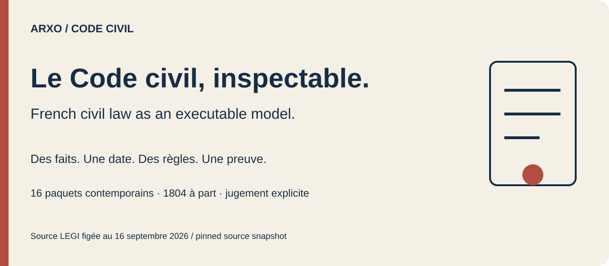
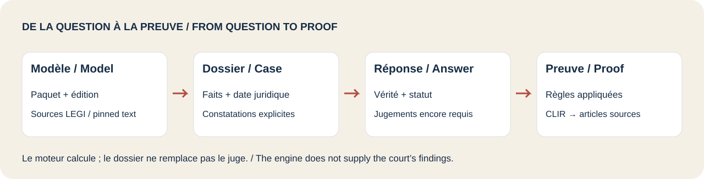
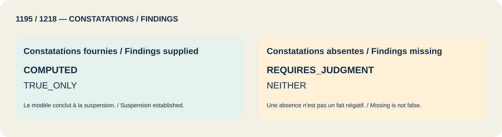
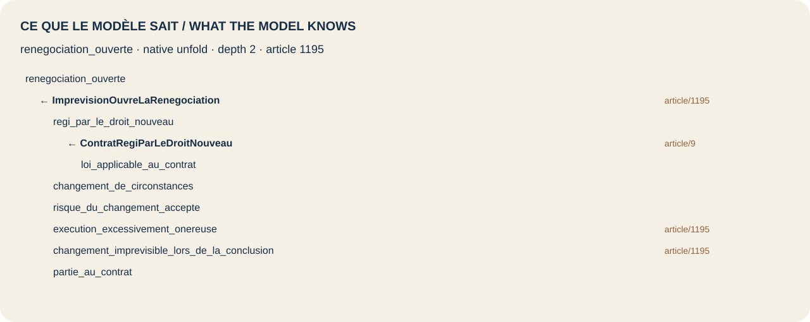

# Arxo Code civil

[](https://smithery.ai/servers/arxohq/code-civil)

[Français](README.md) · [English](README.en.md)

Explorez le Code civil français par **les faits, la date juridique, les constatations du juge et des réponses reproductibles**. Cette livraison réunit 16 paquets contemporains et un modèle historique de 1804. Les textes et étiquettes sources restent français ; les explications anglaises sont non officielles.

[Poser une question](#poser-une-question) · [Choisir un modèle](#choisir-un-modèle) · [Exemples](#exemples) · [Inspecter une preuve](#inspecter-une-preuve) · [Profondeur et limites](#profondeur-et-limites)

## Poser une question

Prérequis : **Node.js 20+** et Git. Le CLI publié `@arxo/cli@0.2.4` prend en charge macOS arm64 et Linux x64. Les modèles sont livrés ici par GitHub ; ils ne forment pas un paquet npm.

```sh
npm install -g @arxo/cli@0.2.4
git clone https://github.com/arxohq/arxo-code-civil.git
cd arxo-code-civil
law eval examples/renegociation-ouverte
```

Réponse attendue : `COMPUTED` / `TRUE_ONLY`. Le modèle établit l’ouverture de la renégociation selon l’article 1195 ; il ne réécrit pas le contrat et ne tranche pas le litige. Comparez le risque accepté et les constatations absentes :

```sh
law eval examples/risque-accepte
law eval examples/jugement-manquant
```

Ces cas donnent `COMPUTED / NEITHER` et `REQUIRES_JUDGMENT / NEITHER`. Absence de preuve, assertion négative et conflit restent distincts.

## Choisir un modèle

**`fr.code_civil` est le paquet de prescription, pas un agrégat de tout le Code.** Choisissez le paquet du sujet. Tous les modèles conservent leur version 0.1.0 ; la source contemporaine est figée au 16 septembre 2026. Ce dépôt n’est pas une vue mise à jour en continu du droit français.

| Paquet / Package | Sujet / Scope | EXECUTABLE | ANCHORED | SOURCE_ONLY | Autres / Other | Unités / Units |
|---|---|---:|---:|---:|---:|---:|
| [`fr.code_civil`](packages/fr.code_civil) | Prescription / limitation | 57 | 0 | 4 | 0 | 61 |
| [`fr.code_civil_1804`](packages/fr.code_civil_1804) | 1804 / historical slice | 53 | 0 | 83 | 939 | 1075 |
| [`fr.code_civil.biens`](packages/fr.code_civil.biens) | Biens / property | 182 | 0 | 19 | 0 | 201 |
| [`fr.code_civil.contrat`](packages/fr.code_civil.contrat) | Contrat / contract | 151 | 0 | 0 | 0 | 151 |
| [`fr.code_civil.contrats_speciaux`](packages/fr.code_civil.contrats_speciaux) | Contrats spéciaux / special contracts | 264 | 0 | 3 | 0 | 267 |
| [`fr.code_civil.core`](packages/fr.code_civil.core) | Titre préliminaire / shared declarations | 8 | 0 | 0 | 0 | 8 |
| [`fr.code_civil.famille`](packages/fr.code_civil.famille) | Famille / family | 52 | 0 | 343 | 0 | 395 |
| [`fr.code_civil.liberalites`](packages/fr.code_civil.liberalites) | Libéralités / gifts and wills | 233 | 0 | 0 | 0 | 233 |
| [`fr.code_civil.mayotte`](packages/fr.code_civil.mayotte) | Mayotte | 18 | 0 | 23 | 0 | 41 |
| [`fr.code_civil.obligations`](packages/fr.code_civil.obligations) | Obligations | 162 | 0 | 0 | 0 | 162 |
| [`fr.code_civil.personnes`](packages/fr.code_civil.personnes) | Personnes / persons | 425 | 0 | 10 | 0 | 435 |
| [`fr.code_civil.regimes_matrimoniaux`](packages/fr.code_civil.regimes_matrimoniaux) | Régimes matrimoniaux / matrimonial property | 100 | 0 | 39 | 0 | 139 |
| [`fr.code_civil.responsabilite`](packages/fr.code_civil.responsabilite) | Responsabilité / liability | 47 | 0 | 1 | 0 | 48 |
| [`fr.code_civil.successions`](packages/fr.code_civil.successions) | Successions / inheritance | 143 | 1 | 123 | 0 | 267 |
| [`fr.code_civil.suretes`](packages/fr.code_civil.suretes) | Sûretés / security | 223 | 0 | 0 | 0 | 223 |
| [`fr.code_civil.transitions`](packages/fr.code_civil.transitions) | Réformes / transition acts | 4 | 0 | 0 | actes / acts | 4 |
| [`fr.code_civil.vente_louage`](packages/fr.code_civil.vente_louage) | Vente et louage / sale and hire | 222 | 0 | 46 | 0 | 268 |
| [`doctrine.ius_privatum`](packages/doctrine.ius_privatum) | Dépendance / dependency | — | — | — | — | not_measured |
| [`calc.allocation`](packages/calc.allocation) | Dépendance / dependency | — | — | — | — | not_measured |
| [`calc.kinship`](packages/calc.kinship) | Dépendance / dependency | — | — | — | — | not_measured |
| [`units.si`](packages/units.si) | Dépendance / dependency | — | — | — | — | not_measured |



## Exemples

| Exemple / Example | Question | Statut / Status |
|---|---|---|
| [`prescription-1804`](examples/prescription-1804) | Dette de 2000, action en 2015 — lecture 1804 | `COMPUTED` / `FALSE_ONLY` |
| [`prescription-actuelle`](examples/prescription-actuelle) | Même dette — droit contemporain et transition 2008 | `COMPUTED` / `TRUE_ONLY` |
| [`contrat-veille-2016`](examples/contrat-veille-2016) | Contrat du 30 septembre 2016 : frontière du paquet | `COMPUTED` / `TRUE_ONLY` |
| [`contrat-jour-2016`](examples/contrat-jour-2016) | Contrat du 1er octobre 2016 : rédaction 2016 | `COMPUTED` / `TRUE_ONLY` |
| [`contrat-2019`](examples/contrat-2019) | Contrat de 2019 : rédaction ratifiée | `COMPUTED` / `TRUE_ONLY` |
| [`renegociation-ouverte`](examples/renegociation-ouverte) | Article 1195 : renégociation ouverte | `COMPUTED` / `TRUE_ONLY` |
| [`risque-accepte`](examples/risque-accepte) | Risque accepté : conclusion non établie | `COMPUTED` / `NEITHER` |
| [`jugement-manquant`](examples/jugement-manquant) | Article 1218 : constatations judiciaires absentes | `REQUIRES_JUDGMENT` / `NEITHER` |
| [`embargo-temporaire`](examples/embargo-temporaire) | Empêchement temporaire : suspension | `COMPUTED` / `TRUE_ONLY` |
| [`embargo-definitif`](examples/embargo-definitif) | Empêchement définitif : résolution | `COMPUTED` / `TRUE_ONLY` |
| [`obligation-active`](examples/obligation-active) | Obligation pendant la renégociation : ACTIVE | `COMPUTED` / `POSITIONS: ACTIVE` |
| [`responsabilite-jugement`](examples/responsabilite-jugement) | Faute : appréciation judiciaire requise | `REQUIRES_JUDGMENT` / `NEITHER` |
| [`reserve-deux-enfants`](examples/reserve-deux-enfants) | Deux enfants : quotité disponible d’un tiers | `COMPUTED` / `TRUE_ONLY` |
| [`legs-reduit`](examples/legs-reduit) | Réduction du legs : €30 000 | `COMPUTED` / `TRUE_ONLY` |
| [`conjoint-quart`](examples/conjoint-quart) | Conjoint survivant : un quart | `COMPUTED` / `TRUE_ONLY` |
| [`veuve-1804`](examples/veuve-1804) | Lecture 1804 : conjoint sans part | `COMPUTED` / `TRUE_ONLY` |
| [`veuve-actuelle`](examples/veuve-actuelle) | Lecture contemporaine : conjoint un quart | `COMPUTED` / `TRUE_ONLY` |

Chaque répertoire contient le `input.lawcase` original, les données canoniques `case.json`, `query.json`, la requête native `request.json` et la réponse `result.json`. Les requêtes sont capturées par le CLI publié à partir des collections existantes ; aucune seconde sémantique juridique en Python ou JavaScript n’est ajoutée. `origin adjudicated`, négations explicites et politiques de dates sont conservés. Les [collections natives](collections) permettent aussi `law ask`.

```sh
law ask collections/imprevision-force-majeure --case PrixEnHausse \
  --query-json collections/imprevision-force-majeure/queries/renegociation-ouverte.json \
  --format json
```



## Inspecter une preuve

```sh
law inspect examples/renegociation-ouverte/result.json summary
```

La réponse contient le statut de vérité et d’évaluation, les jugements requis, un graphe de preuve et les empreintes canoniques. Suivez les identifiants des règles vers les [règles du contrat](packages/fr.code_civil.contrat/chapitre-04-s5-inexecution.law) ou le [monde lié](registry/world/fr.code_civil.contrat.lawir.json).

**Limite du CLI :** la version 0.2.4 laisse `sourceAnchors` vide dans l’évaluation de ces exemples. La règle appliquée et ses `anchors` dans le modèle sont contrôlés séparément ; l’arbre natif ci-dessous résout les articles. Un tableau vide ne signifie pas une absence de source. [Vérification](reports/verification.json).

<details>
<summary>Article 1195 — native unfold, depth 2</summary>



[Native document](assets/unfold-renegociation.json).

```sh
law engine unfold registry/world/fr.code_civil.contrat.lawir.json \
  renegociation_ouverte --clir registry/package --depth 2 --lang fr --json
```

</details>

## Profondeur et limites

Le tableau mesure l’**édition contemporaine épinglée** pour les paquets du Code. Leur dénominateur cumulé est de **2 899 articles**. Les actes de transition ont un dénominateur distinct de quatre unités. Le texte capturé de 1804 compte 1 075 unités propres, dont 939 hors de la portée ancrée du modèle. Les anciennes rédactions contemporaines figurent séparément dans le [rapport par unité](reports/formalization-depth.json), sans gonfler le dénominateur contemporain.

`EXECUTABLE` constate un nœud de dérivation ou de contrôle rattaché à l’article. Cela n’établit pas une formalisation complète de chaque alinéa ou conséquence. `ANCHORED` et `SOURCE_ONLY` restent visibles ; les dépendances de calcul ou de déclarations n’ont pas de dénominateur juridique mesuré. La mesure emploie le classificateur existant `boundaries.depth`, uniquement les nœuds propres au paquet, avec empreintes des entrées et de l’implémentation.

Un contrat antérieur à la réforme hors du paquet est **une frontière du modèle, pas une absence de droit**. Le modèle de 1804 est un sillon historique, pas tout le Code historique. Le moteur n’invente pas les constatations du juge, ne partage pas la succession, ne choisit pas le remède et ne fournit pas toutes les lois ou procédures externes. Positions normatives et propositions institutionnelles sont des résultats distincts. Consultez les [limites de chaque paquet](packages).

## Reproduire les vérifications sélectionnées

```sh
law test packages/fr.code_civil.core --file tests/titre-preliminaire.lawtest --json
# Optional maintainer checks / vérification facultative : Python 3.12+
python3.12 tools/check.py
```

Preuves locales : 89 scénarios dans des fichiers déclarés sélectionnés, plus un test allocation et sa propriété ; 17 exemples lecteurs. La déclaration historique d’allocation omet `world` : le refus du test natif du paquet est conservé, le test direct est rapporté à part. `units.si` n’annonce pas de suite. Aucune acceptation exhaustive des paquets ou du corpus n’est revendiquée. `releaseVerified: false` ; corpus `not_checked`. [Livraison](docs/DELIVERY.md) · [Sources épinglées](source-pin.json) · [Runtime](toolchain.lock.json) · [Inventaire exact](CANON-MANIFEST.json).

## Sources et licence

Code des modèles et exemples : [Apache-2.0](LICENSE). Textes LEGI capturés : DILA, [Licence Ouverte 2.0](https://www.data.gouv.fr/pages/legal/licences/etalab-2.0), état des sources au 2026-09-16. Transcription historique : Wikisource, attribution et partage dans les mêmes conditions conservés séparément. [NOTICE](NOTICE) indique adresses, dates de récupération et empreintes. Démonstration indépendante de recherche, sans affiliation à la DILA ou à l’État français.
